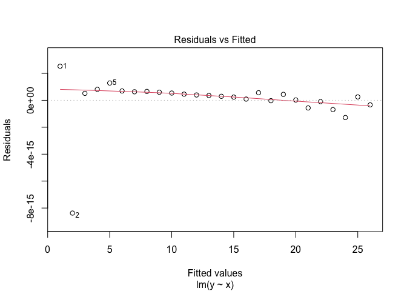
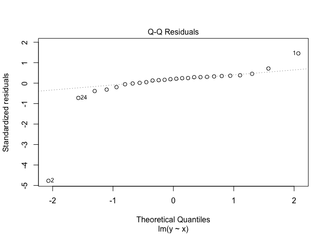
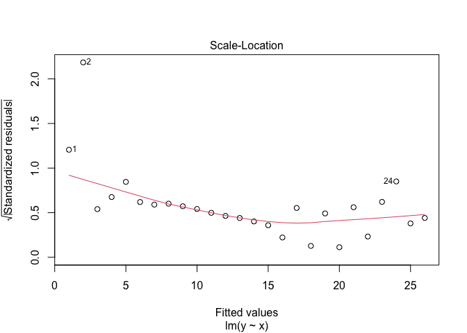
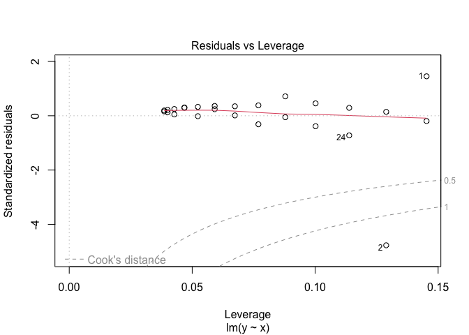
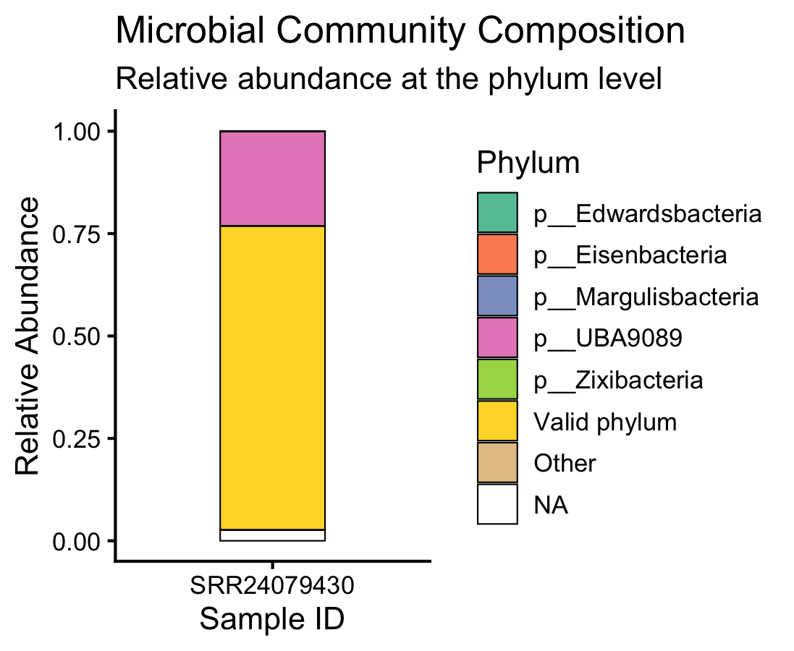

# BZD07
MS

## test quarto

``` r
library(tidyverse)
```

    ── Attaching core tidyverse packages ──────────────────────── tidyverse 2.0.0 ──
    ✔ dplyr     1.1.4     ✔ readr     2.1.5
    ✔ forcats   1.0.1     ✔ stringr   1.5.2
    ✔ ggplot2   4.0.0     ✔ tibble    3.3.0
    ✔ lubridate 1.9.4     ✔ tidyr     1.3.1
    ✔ purrr     1.1.0     
    ── Conflicts ────────────────────────────────────────── tidyverse_conflicts() ──
    ✖ dplyr::filter() masks stats::filter()
    ✖ dplyr::lag()    masks stats::lag()
    ℹ Use the conflicted package (<http://conflicted.r-lib.org/>) to force all conflicts to become errors

``` r
print("Ahoj")
```

    [1] "Ahoj"

``` r
a <- LETTERS
b <- letters
c <- "test"
x <- 1:26
y <- 1:26
```

text radom znaky sadfadgdsgd sagd

``` python
print("Ahoj")
```

    Ahoj

``` r
mod <- lm(y ~ x)
plot(mod)
```









``` r
write_tsv(mpg, "mpg.tsv")

saveRDS(mod, "mod.RDS")
mod <- readRDS("mod.RDS")

write_rds(mod, "mod.RDS")
```

Ukazka vlkadani obrazku 
